# Mimo prototype UX/UI review — 5 November 2026

This is an expert review of representative teacher flows and the student preview, using fresh screenshots captured during this task. It is not a user usability study or a full accessibility conformance audit. The teacher goal is to prepare and publish useful lessons with little administration, then review student work efficiently.

## Completed changes

- Consolidated duration and pricing into Edit teaching profile; removed the separate Lesson Settings screen and entry.
- Removed optional from these profile labels, with required-before-publishing guidance. Onboarding remains deferable.
- Moved the requirement from availability/meeting confirmation to student-facing lesson publication, including the older share confirmation route. Draft saving and reusable template creation do not require pricing.
- Added recovery from publishing to the existing profile editor, saving the lesson draft before leaving and returning to its editor after saving the profile.
- Preserved explicit confirmation for €0 and reset-on-price-change behavior. Existing bookings are unchanged.
- Made the teacher account menu opaque, above surrounding content, with an opaque highlighted state.
- Fixed the negative/out-of-range price dead end with an inline, associated error.

## Remaining priorities

| Priority | Observation | Recommendation | Evidence |
| --- | --- | --- | --- |
| High | A persistent success notice covers editor actions. | Position notices outside the action row; use appropriate temporary success messaging while retaining persistent errors. | Step 4 |
| High | Selected availability days have weak visual text contrast. | Correct selected text colors and test all interaction states. | Step 3 |
| Medium | Mobile footer has 11px action labels. | Enlarge readable labels and touch areas; test the layout on real phones with teachers. | Step 8 |
| Medium | Module results starts with a large context card before any work to review. | Compact context, jump-to-block, next-unreviewed, and visible reviewed counts. | Step 7 |
| Medium | Profile session duration and summed lesson-content minutes can differ; Apply changes covers two outcomes. | Distinguish session duration from estimated study time; clarify student publication versus template saving. Show a final summary of audience, version and applicable terms. | Steps 4–5; ready-state evidence below |
| Medium | Profile languages/levels accept free text while onboarding uses choices. | Reuse controlled language/CEFR selections with a deliberate custom option. | Step 2 |

These are recommendations for the next iteration; they have not been silently implemented in this scoped update. Profile/availability state is still a session simulation, while editor drafts and feedback use browser-local storage. Make that distinction visible before testing refresh/revisit expectations; production needs account-backed saving and delivery.

## Nielsen heuristic coverage

Assessment lens: [NNG’s 10 usability heuristics](https://www.nngroup.com/articles/ten-usability-heuristics/). Findings below are my observations of this prototype, not claims from NN/G about this app.

| Heuristic | Current evidence and remaining work |
| --- | --- |
| Visibility of system status | Draft/applied and review states exist. Notices should not obscure actions; clarify persistence scope. |
| Match with the real world | Module learning focus and Teach/Practise fit teacher tasks. Clarify the two duration meanings. |
| User control and freedom | Back, undo/redo, separate saving and applying, and recoverable profile setup support control. Consider unsaved-profile exit guidance. |
| Consistency and standards | Profile now has one location for lesson details. Reuse onboarding language/level choices in profile. |
| Error prevention | Missing publishing details and unconfirmed free pricing block publication; drafts remain possible. Add gentle level/duration mismatch checks rather than forbidding teacher judgment. |
| Recognition rather than recall | Visible outline, goals and queue reduce memory work. Block navigation would help lengthy reviews. |
| Flexibility and efficiency | Templates, saved comments, filters and full phone editing support repeat work. Prioritize oldest unreviewed responses. |
| Aesthetic and minimalist design | Account menu is readable; ongoing modules separates two tasks. Results context and mobile controls need simplification. |
| Error recognition and recovery | Email, price and publish errors provide recovery. Extend field-specific guidance to other profile validation. |
| Help and documentation | Contextual explanations and simulation labels exist. Test whether teachers understand draft versus applied versus shared. Help content was not audited here. |

## Captured steps

### 1. Teacher account menu

**Health:** Good after fix.

Solid white surface now hides underlying content. Navigation labels are readable. Keyboard and screen-reader testing beyond the sampled interaction remains necessary.

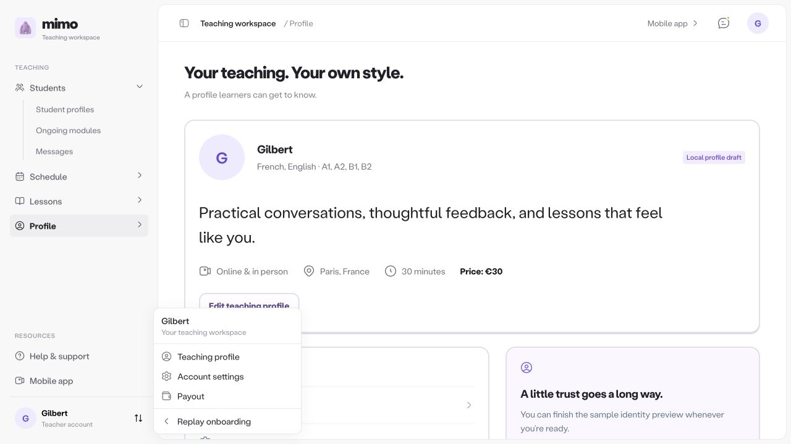

### 2. Edit teaching profile

**Health:** Good after fix; some form risks remain.

Duration and price no longer say optional here; helper text states required before publishing and allows saving an incomplete profile. Negative price now has a field-associated alert. Teaching languages and levels remain free text, unlike onboarding choices: replace them with consistent multi-select controls in a later pass.

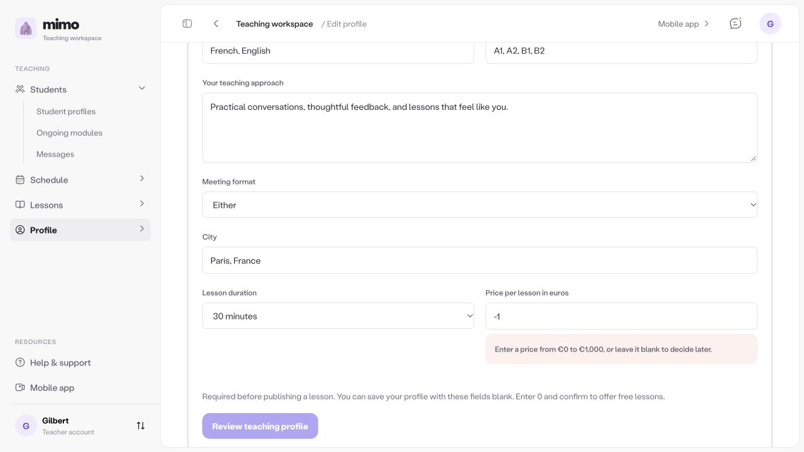

### 3. Availability

**Health:** Works; visual contrast risk.

With both saved profile fields blank, Save availability remained available and succeeded. Selected day labels appear dark/brown over saturated purple, unlike the readable primary button. Use a contrasting selected-state label and verify computed contrast.

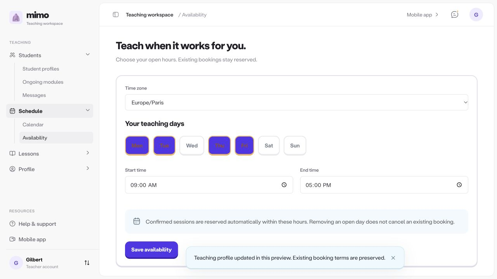

### 4. Desktop module editor

**Health:** Works; notice obstruction.

Modules / Teach / Practise and Lesson / Module / Block make the hierarchy visible. Persistent notice overlaps the Preview lesson area in the footer. Move notices above the action bar and dismiss routine success notices automatically with sufficient reading time.

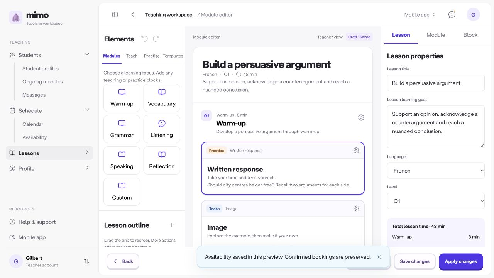

### 5. Publish and recover missing details

**Health:** Good prevention; terminology needs refinement.

Publishing for a selected student reports both missing fields and offers Edit teaching profile. Recovery saves the lesson draft first and returns to that same editor after profile save. Private templates remain available without pricing. Existing Apply changes terminology still combines reusable template saving and student publication; make the final result clearer.

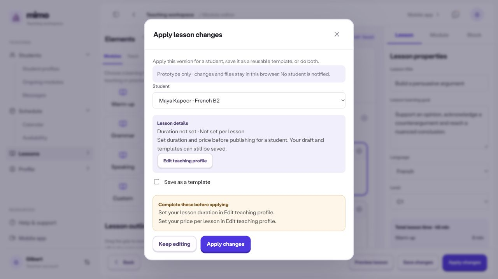

### 6. Review queue

**Health:** Good structure; needs faster triage at scale.

Separate Review queue and Lessons by student are visible. Status/search and response counts help teachers act. Add pending totals and oldest-first prioritization when submissions grow; no proficiency judgment should be inferred.

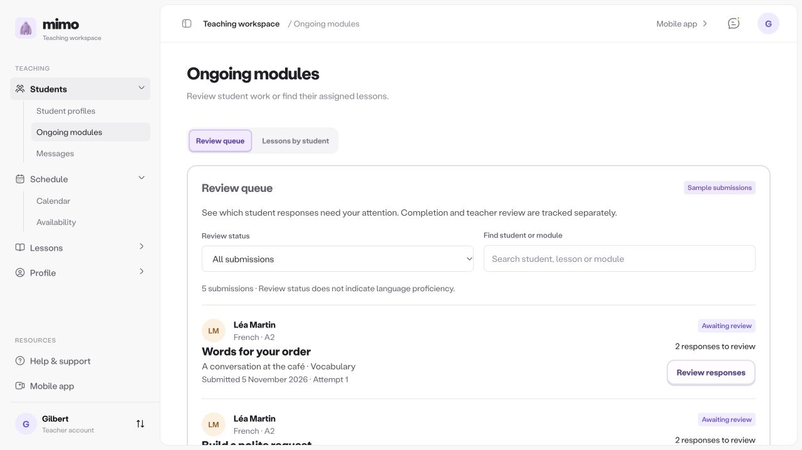

### 7. Speaking/writing module results

**Health:** Useful context; too much scrolling.

Student and module goals are explicit, and the student submission is preserved. At 1280×720 the first response is below the initial viewport. Add a compact block navigator and next-unreviewed action, and reduce the large introductory card. Structured feedback and optional detailed tools can remain progressively disclosed.

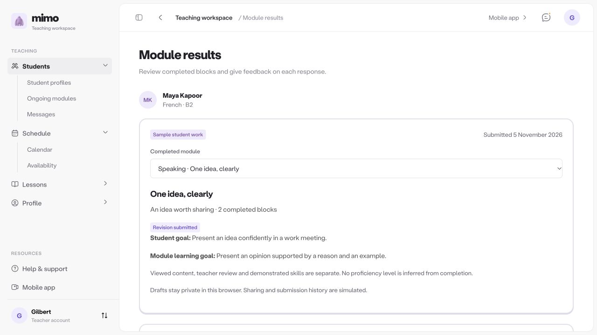

### 8. Mobile authoring

**Health:** Functional; readability needs improvement.

Elements / Canvas / Properties preserve full editing on phones. Sampled Preview lesson computed font was 11px and height 40px. These are readability/touch risks, not proof of a WCAG failure. Increase label sizes and target comfort; consider fewer primary footer actions before changing the requested one-row layout.

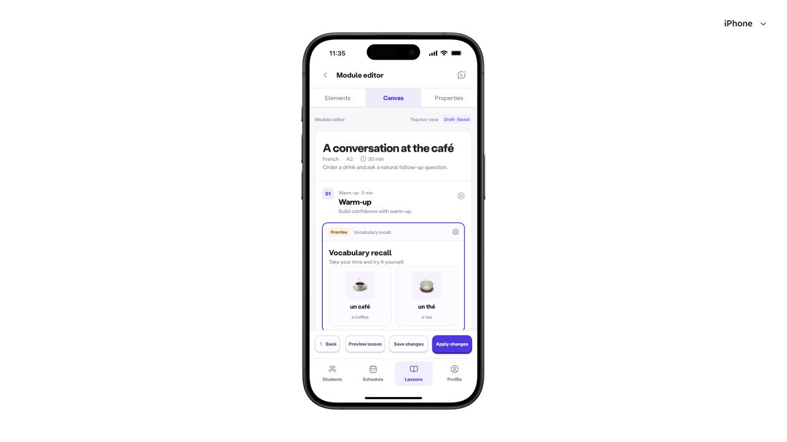

### 9. Mobile student preview and answer reveal

**Health:** Good answer feedback; navigation needs intent decision.

One block at a time retains module context. Wrong answer → Submit → Reveal shows Incorrect, learner answer and teacher answer, plus Try again. Next block is available before answering: clarify whether skipping is permitted, and distinguish skipped from completed work if retained. This is a design decision, not necessarily a defect.

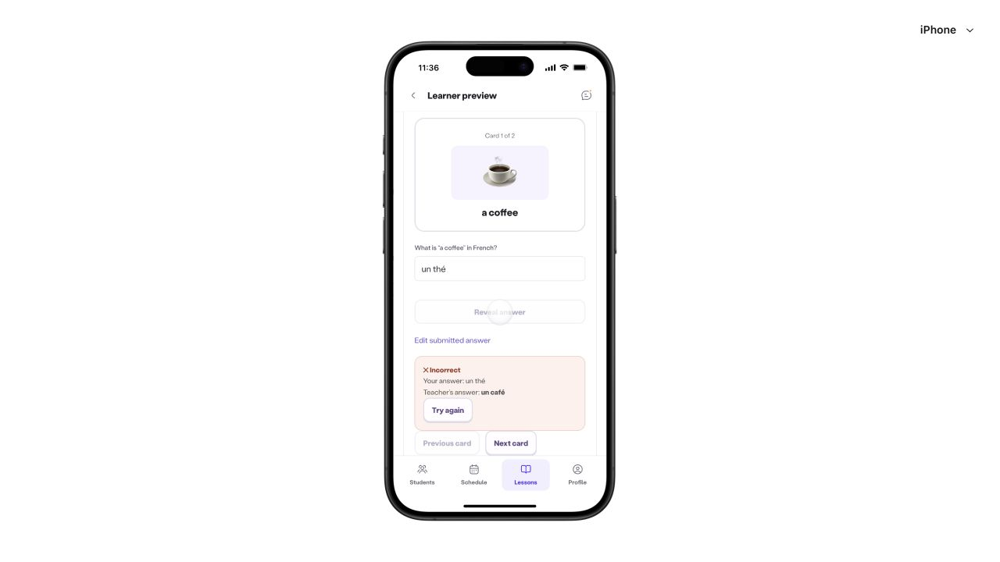

### 10. Account onboarding

**Health:** Good grouping and error recovery.

Email and Google are adjacent alternatives. An invalid email has explicit guidance and disables email continuation while Google remains available. Step 3 of 8 is visible. This sampled review did not rerun the complete guardian/document branches.

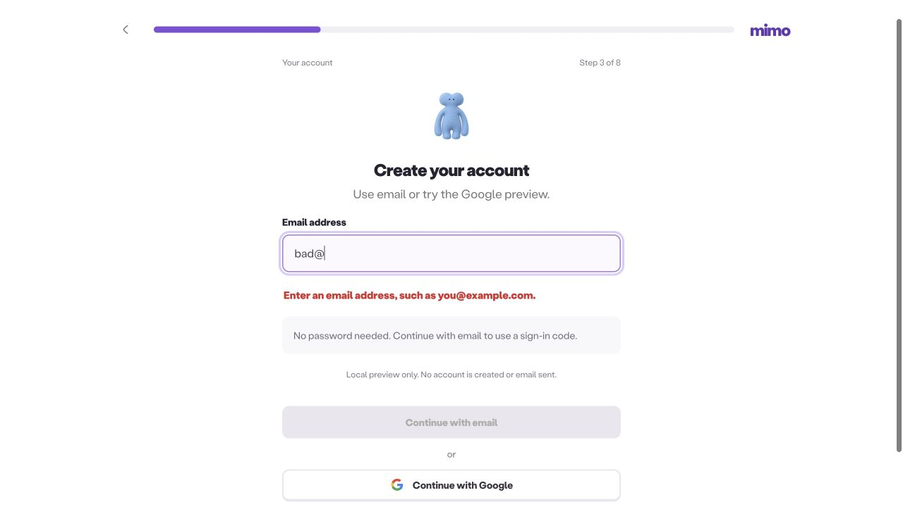

### Supporting publication-ready state

After confirmation and profile save, the same lesson editor returned, showing 45 minutes and Free (€0) in its publication dialog. The lesson content estimate remained 48 minutes, and a C1 lesson could be selected for a B2 learner without a contextual warning. These examples ground the terminology and mismatch recommendations; teacher choice should remain possible.

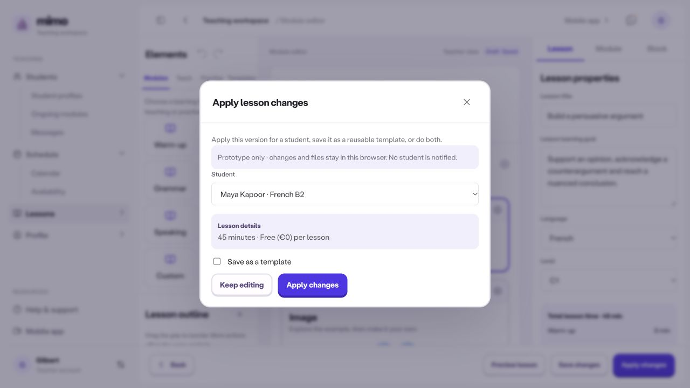

## Checks and limits

Production build and all 28 protected runtime hashes passed. 20 onboarding, 29 teacher/editor, 5 routing and 4 Sites checks passed: 58 tests. The Site build and worker checks passed again with matching copied source. Fresh browser checks exercised account grouping/invalid email, opaque menu, profile invalid price and incomplete save, free confirmation, availability save without pricing, publication gate and return to the same editor, review queue/results, phone editor and student incorrect-answer reveal.

This run did not exhaustively test every block format, identity branch, storage failure or offline state. Real authentication, verification, charging, student delivery, and cross-device synchronization remain unconnected. No physical-device, screen-reader, zoom/reflow or full contrast audit was performed. Screenshots alone cannot prove accessibility compliance. Previously existing browser-local sample drafts/feedback can affect the visible sample queue and library; they are not real student records.
